# Informe · Etapa 3 — Carga masiva de datos

**TPI Bases de Datos · Bodegas del Atuel · UTN FRSR · 2026**

Script: [`db/seed/seed_db.py`](../db/seed/seed_db.py) · Instrucciones: [`db/seed/README.md`](../db/seed/README.md)
Corrida de referencia: PostgreSQL 18.6 (Windows), Python 3.10, semilla `42`, fecha de referencia `2026-11-01`.

---

## 1. Resultado

| Criterio de aceptación | Resultado |
|---|---|
| Todas las tablas con al menos una fila | ✅ 30 de 30 |
| Al menos 3 tablas con más de 10.000 filas | ✅ 5 (`renglon_comprobante`, `comprobante`, `cliente`, `socio`, `renglon_transferencia`) |
| Al menos una tabla con más de 100.000 filas | ✅ `renglon_comprobante`: 515.977 · `comprobante`: 150.000 |
| Dos ejecuciones con la misma semilla producen los mismos datos | ✅ Verificado (sección 8) |
| Las consultas de control no encuentran inconsistencias | ✅ 19 controles en 0 (sección 7) |
| Comparación fila por fila vs. por lotes | ✅ Sección 6 |
| Manejo de triggers documentado | ✅ Sección 5 |

### Filas por tabla

| Tabla | Filas | Recomendado | | Tabla | Filas | Recomendado |
|---|---:|---|---|---|---:|---|
| renglon_comprobante | 515.977 | 500.000 o más | | stock_sala | 1.792 | 500 a 5.000 |
| comprobante | 150.000 | 150.000 | | vino_maridaje | 1.405 | 300 a 1.000 |
| cliente | 20.000 | 20.000 | | composicion_vino | 1.286 | 300 a 1.000 |
| socio | 16.015 | — | | exportador | 1.009 | — |
| renglon_transferencia | 15.876 | 3.000 a 15.000 | | vino | 741 | 300 a 1.000 |
| analisis_calidad | 5.536 | 3.000 a 15.000 | | parcela | 718 | 300 a 1.000 |
| auditoria_precio | 4.962 | — | | stock_deposito | 681 | 300 a 1.000 |
| renglon_ingreso | 4.779 | 3.000 a 15.000 | | empleado | 125 | 15 a 150 |
| transferencia | 4.448 | 500 a 5.000 | | transportista_localidad | 73 | 10 a 60 |
| lote_uva | 3.308 | 3.000 a 15.000 | | finca | 60 | 15 a 150 |
| distribuidor | 2.976 | — | | sala_venta | 25 | 15 a 150 |
| ingreso | 2.914 | 500 a 5.000 | | bodega | 20 | 10 a 60 |
| permiso_exportacion | 2.422 | — | | departamento | 18 | catálogo |
| | | | | transportista | 15 | 10 a 60 |
| | | | | cepa / localidad / maridaje | 12 / 11 / 8 | catálogo |

`vino_maridaje` y `composicion_vino` superan levemente el rango sugerido porque cada vino tiene entre 1 y 3 maridajes y algunos cortes llevan 2 a 4 cepas; `renglon_transferencia` y `transportista_localidad` quedan apenas por encima. Se priorizó la coherencia del modelo por sobre ajustar exactamente al rango orientativo.

---

## 2. Catálogos reales y datos generados

Los catálogos **no se generan al azar**: se cargan desde CSV (anexo B del enunciado).

| CSV | Tabla | Contenido |
|---|---|---|
| `cepas.csv` | `cepa` | 7 tintas y 5 blancas (Malbec, Cabernet Sauvignon, …, Semillón) |
| `maridajes.csv` | `maridaje` | 8 maridajes con su temperatura de servicio |
| `departamentos.csv` | `departamento` | 18 departamentos de Mendoza |
| `localidades.csv` | `localidad` | 11 localidades con código postal y encargado regional |

El resto se genera con **Python + Faker (`es_AR`) + `random`**, con semilla fija. Los nombres de bodegas, fincas, clientes y transportistas son ficticios. Los CUIT/CUIL llevan dígito verificador válido (módulo 11), así que además de cumplir el `DOMAIN cuit_dom` son CUIT plausibles.

---

## 3. Orden de carga

Se carga primero lo que no depende de nada y después lo que depende de ello (orden topológico de las claves foráneas). Las flechas indican "depende de".

```mermaid
flowchart LR
    subgraph N0["Nivel 0 · sin dependencias"]
        localidad; departamento; cepa; maridaje; bodega; transportista
    end
    subgraph N1["Nivel 1"]
        sala_venta; transportista_localidad; finca; vino; cliente
    end
    subgraph N2["Nivel 2"]
        empleado; parcela; composicion_vino; vino_maridaje; socio; distribuidor; exportador; auditoria_precio
    end
    subgraph N3["Nivel 3"]
        lote_uva; permiso_exportacion; ingreso; transferencia; comprobante
    end
    subgraph N4["Nivel 4"]
        analisis_calidad; renglon_ingreso; renglon_transferencia; renglon_comprobante; stock_deposito; stock_sala
    end
    N1 --> N0
    N2 --> N1
    N3 --> N2
    N4 --> N3
```



| Nivel | Tablas | Depende de |
|---|---|---|
| 0 | localidad, departamento, cepa, maridaje (CSV) · bodega, transportista | — |
| 1 | sala_venta, transportista_localidad | localidad (+ transportista) |
| 1 | finca | departamento |
| 1 | vino | bodega |
| 1 | cliente | localidad |
| 2 | empleado | sala_venta |
| 2 | parcela | finca, cepa |
| 2 | composicion_vino, vino_maridaje | vino, cepa / maridaje |
| 2 | socio, distribuidor, exportador | cliente |
| 2 | auditoria_precio | vino |
| 3 | lote_uva | parcela, bodega |
| 3 | permiso_exportacion | exportador |
| 3 | ingreso | transportista, bodega |
| 3 | transferencia | sala_venta |
| 3 | comprobante | cliente, sala_venta |
| 4 | analisis_calidad | lote_uva |
| 4 | renglon_ingreso / renglon_transferencia / renglon_comprobante | su cabecera + vino |
| 4 | stock_deposito / stock_sala | vino (+ sala_venta) |

El script respeta este orden y además empieza con `TRUNCATE ... RESTART IDENTITY CASCADE` sobre las 30 tablas, de modo que siempre parte de la base vacía.

---

## 4. Cómo se generan datos coherentes

El punto difícil de la etapa es que los datos **cierren entre sí** (paso 4 del enunciado: fechas lógicas, porcentajes que suman 100, descuentos consistentes, stock nunca negativo). En lugar de generar cada tabla por separado, el script **simula la operación de la empresa día por día durante 6 años** (del 01/11/2020 al 01/11/2026):

1. **Vinos.** Cada bodega tiene de 4 a 6 líneas de producto (por ejemplo, "Atuel Malbec Reserva"), con una o más presentaciones (375, 750 y 1500 ml) y una añada por año. Cada vino tiene una **fecha de lanzamiento** = cosecha de su añada + meses de crianza según el nivel (Joven 5, Roble 12, Reserva 18, Gran Reserva 30, Ícono 40). Un vino no se mueve antes de esa fecha: *la cosecha va antes que la elaboración*.
2. **Composición.** Varietales al 100 % o con un 85–95 % de la cepa principal (como exige la normativa argentina para rotular un varietal) y cortes de 2 a 4 cepas en múltiplos de 5. **Siempre suma 100**, y se carga con el constraint trigger de RN-05 activo.
3. **Precios.** Cada vino tiene un precio a la fecha de referencia y **aumentos semestrales** (1 de enero y 1 de julio) con tasas por año que imitan la inflación. Cada aumento se registra en `auditoria_precio`, y **cada venta usa el precio vigente en su fecha**.
4. **Clientes.** 80 % socios, 15 % distribuidores y 5 % exportadores, cada uno **con su fila de subtipo** (jerarquía total y disjunta). El descuento **no lo envía el script**: lo completa el trigger `trg_descuento_cliente` con `fn_descuento_cliente` (10/20/30 %). Los exportadores tienen de 1 a 5 permisos con vencimiento posterior a la emisión. Un 4 % de los socios nunca compra (consignas D4 y D6).
5. **Movimientos de stock** (simulación diaria):
   - **Ingresos:** cada lunes, si el stock de un vino vigente en el depósito baja de 3 semanas de demanda, su bodega envía 7 semanas de demanda (en cajas de 6). Se agrupan hasta 6 vinos por ingreso.
   - **Transferencias:** cada sala revisa su surtido cada 14 días (nunca en su día de cierre) y pide al depósito lo que le falta, **limitado a lo que el depósito tiene**.
   - **Ventas:** 150.000 comprobantes repartidos con crecimiento anual, estacionalidad (diciembre +55 %) y más ventas los fines de semana. Una venta **solo puede vender lo que la sala tiene en stock**, nunca se hace el día de cierre de la sala y siempre es posterior al alta del cliente.
   - Los documentos de los últimos 12 días pueden quedar **sin procesar** (`en_confeccion` o `terminado`), lo que da datos para las consultas de pendientes (S5).
6. **Importes.** Se calculan con `Decimal` (nunca `float`) usando la misma fórmula que `fn_subtotal_renglon`: `ROUND(cantidad × precio × (1 − descuento/100), 2)`. La cabecera guarda subtotal bruto, descuento y total.
7. **Producción de uva.** 60 fincas con 8 a 16 parcelas cada una. Cada parcela se cosecha a lo sumo una vez por campaña (RN-04), en febrero las blancas y en marzo–abril las tintas, con un rendimiento por hectárea que depende de la edad del viñedo y del clima de cada año (consigna S10). La uva va a una bodega que elabora vinos de esa cepa.

El **stock final** de cada sala y del depósito no se inventa: es el resultado de todos los movimientos simulados. Por eso la conciliación de stock (sección 7) da exacta.

---

## 5. Estrategia frente a los triggers

### Problema

Los triggers de la Etapa 2 están pensados para la operación diaria, no para cargar historia:

- `trg_fecha_transferencia` fuerza `fecha_confeccion = CURRENT_DATE` → imposible cargar transferencias de años anteriores.
- `trg_estado_ingreso` / `trg_estado_transferencia` exigen nacer `en_confeccion` y pasar a `procesado` solo con el procedimiento.
- `trg_validar_stock_venta` y `trg_actualizar_stock_y_totales` descuentan stock fila por fila: con 516.000 renglones la carga sería muy lenta y obligaría a cargar stock y ventas intercalados en orden cronológico.
- `trg_proteger_importes` rechaza una cabecera con importes ya calculados.

### Decisión

| Tablas | Triggers durante la carga | Por qué |
|---|---|---|
| `ingreso`, `renglon_ingreso`, `transferencia`, `renglon_transferencia`, `comprobante`, `renglon_comprobante` | **Deshabilitados** con `ALTER TABLE ... DISABLE TRIGGER USER` | Es historia ya ocurrida: el script calcula fechas, estados, importes y stock resultante |
| `cliente`, `socio`, `distribuidor`, `exportador` | **Activos** | El trigger completa el descuento (RN-06) y los constraint triggers validan la jerarquía al cerrar la transacción |
| `vino`, `composicion_vino` | **Activos** | RN-05 (corte = 100) se valida con el constraint trigger diferido |
| Resto | **Activos** | No tienen triggers que impidan la carga |

Se usa **`DISABLE TRIGGER USER` y no `DISABLE TRIGGER ALL`**: `ALL` también apaga los triggers internos que implementan las **claves foráneas** (y requiere superusuario). Con `USER` las FK siguen controlándose durante toda la carga: no puede quedar un renglón apuntando a un vino o a un comprobante inexistente.

### Riesgos y cómo se mitigan

| Riesgo | Mitigación |
|---|---|
| Cargar datos que violen una regla que el trigger habría rechazado (stock negativo, total mal calculado, fecha incoherente) | **19 consultas de control** dentro de la misma transacción, antes del `COMMIT`. Si alguna encuentra un problema, se lanza una excepción y **se revierte toda la carga** |
| Olvidar volver a habilitar los triggers | `ENABLE TRIGGER USER` se ejecuta dentro de la misma transacción. Si el script falla antes, el `ROLLBACK` deshace también el `DISABLE` (en PostgreSQL el `ALTER TABLE` es transaccional) |
| Que otra sesión opere con los triggers apagados | `ALTER TABLE` toma un bloqueo `ACCESS EXCLUSIVE` hasta el final de la transacción: nadie puede leer ni escribir esas tablas mientras están deshabilitados |
| Constraint triggers diferidos que fallen recién en el `COMMIT` | Antes de los controles se ejecuta `SET CONSTRAINTS ALL IMMEDIATE`, que valida en ese momento todo lo pendiente |
| Identidades desfasadas (los movimientos se cargan con ID explícito) | Al terminar, `setval` de cada secuencia de identidad al máximo ID cargado + 1 |
| Requiere privilegios | Se ejecuta como `propietario`, dueño de las tablas; no hace falta superusuario |

Después de la carga, la suite `tests/db_tests.sql` corre sobre la base cargada con todos los triggers activos: **92 de 92 casos OK**.

---

## 6. Eficiencia: fila por fila vs. por lotes

Se insertaron las **mismas 10.000 filas** de `renglon_comprobante` en una tabla temporal con la misma estructura y constraints, con tres métodos:

| Método | Segundos | Filas/s | Relación |
|---|---:|---:|---:|
| Fila por fila (`cursor.execute` en un bucle) | 1,71 | 5.839 | ×1 |
| Por lotes (`execute_values`, 5.000 filas por sentencia) | 0,20 | 48.860 | **×8,4** |
| `COPY FROM STDIN` | 0,03 | 304.056 | **×52** |

**Por qué.** Fila por fila hay un viaje de ida y vuelta cliente-servidor y un análisis de la sentencia por cada fila. `execute_values` arma un único `INSERT ... VALUES (...), (...), ...` con miles de filas: un viaje y un análisis por lote. `COPY` directamente transmite los datos en formato de texto plano sin pasar por el analizador de SQL.

Extrapolado a los 515.977 renglones: fila por fila serían ~88 s solo de inserción; por lotes se cargaron en 24,5 s con todas las FK activas.

Se eligió `execute_values` para toda la carga porque es lo que pide el enunciado, mantiene el SQL visible y el tiempo total (~1 minuto) es más que aceptable. `COPY` queda como alternativa si el volumen creciera un orden de magnitud.

### Tiempos de inserción por tabla (`execute_values`)

| Tabla | Filas | Segundos | Filas/s |
|---|---:|---:|---:|
| renglon_comprobante | 515.977 | 24,51 | 21.049 |
| comprobante | 150.000 | 8,19 | 18.310 |
| cliente + subtipos + permisos (triggers activos) | 20.000 | 4,38 | 4.570 |
| renglon_transferencia | 15.876 | 0,50 | 31.527 |
| auditoria_precio | 4.962 | 0,20 | 25.199 |
| renglon_ingreso | 4.779 | 0,16 | 30.793 |
| transferencia | 4.448 | 0,13 | 34.190 |
| ingreso | 2.914 | 0,15 | 19.188 |

Tiempo total de la carga: **61 s** (11 s de simulación en Python y el resto de inserción, controles y `ANALYZE`).

La carga de clientes es la más lenta por fila porque se hace **con los triggers activos** (completar el descuento y validar la jerarquía). Es el costo de que la base garantice las reglas.

---

## 7. Consultas de control

Se ejecutan automáticamente al final de la carga (`CONTROLES` en `seed_db.py`). Cada una cuenta filas con problema; **todas deben dar 0**.

| # | Control | Qué detecta | Resultado |
|---:|---|---|---:|
| 1 | Tablas sin filas | Alguna de las 30 tablas vacía | 0 |
| 2 | Renglones huérfanos | Renglón de venta sin comprobante | 0 |
| 3 | Comprobantes sin renglones | Cabecera vacía | 0 |
| 4 | Subtotal de renglón | `subtotal <> fn_subtotal_renglon(...)` | 0 |
| 5 | Total del comprobante | Cabecera distinta de la suma de sus renglones | 0 |
| 6 | Descuento del renglón | Distinto del descuento del cliente | 0 |
| 7 | Descuento del cliente | Distinto de `fn_descuento_cliente(tipo)` | 0 |
| 8 | Venta anterior al alta | `comprobante.fecha < cliente.fecha_alta` | 0 |
| 9 | Venta en día de cierre | Venta en el `dia_cierre` de la sala | 0 |
| 10 | Precio histórico | Precio del renglón distinto del vigente según la auditoría | 0 |
| 11 | Precio actual | Último precio auditado distinto de `vino.precio` | 0 |
| 12 | Añada | Vino ingresado antes de su añada | 0 |
| 13 | Composición | Corte que no suma 100 | 0 |
| 14 | Jerarquía de clientes | Cliente sin su subtipo o en otra subtabla | 0 |
| 15 | Stock negativo | Sala o depósito con cantidad < 0 | 0 |
| 16 | **Conciliación del depósito** | Σ ingresos procesados − Σ transferencias procesadas ≠ stock del depósito | 0 |
| 17 | **Conciliación de salas** | Σ transferencias procesadas − Σ ventas ≠ stock de la sala | 0 |
| 18 | Calidad | Análisis anterior a la cosecha o cosecha futura | 0 |
| 19 | Superficies | Parcelas que suman más que su finca | 0 |

Los controles 16 y 17 son los más fuertes: prueban que **cada botella** en stock se explica por los movimientos registrados. Ejemplo (control 17):

```sql
SELECT count(*) FROM (
    SELECT id_sala, cod_vino, SUM(q) AS q FROM (
        SELECT t.id_sala, r.cod_vino, r.cantidad AS q
          FROM renglon_transferencia r JOIN transferencia t USING (nro_solicitud)
         WHERE t.estado = 'procesado'
        UNION ALL
        SELECT c.id_sala, r.cod_vino, -r.cantidad
          FROM renglon_comprobante r JOIN comprobante c USING (nro)
    ) mov
    GROUP BY id_sala, cod_vino
) m
FULL JOIN stock_sala s USING (id_sala, cod_vino)
WHERE COALESCE(m.q, 0) <> COALESCE(s.cantidad, 0);   -- resultado: 0
```

Los huérfanos por FK no pueden existir porque las FK quedaron activas; el control 2 se incluye igual como evidencia, tal como pide el enunciado.

---

## 8. Reproducibilidad

| Fuente de variación | Cómo se controla |
|---|---|
| Números aleatorios | Una única instancia `random.Random(42)` y `Faker.seed_instance(42)` |
| Fecha de "hoy" | Parámetro `--fecha-ref` (por defecto `2026-11-01`). El script nunca usa la fecha del sistema |
| Datos previos en la base | `TRUNCATE ... RESTART IDENTITY CASCADE` al empezar |
| IDs autogenerados | Los movimientos se insertan con ID explícito (`OVERRIDING SYSTEM VALUE`) |
| Versiones de librerías | `db/seed/requirements.txt` fija `Faker==40.44.0` y `psycopg2-binary==2.9.13` (otra versión de Faker puede generar otros nombres) |

**Verificación.** Se ejecutó el script dos veces seguidas y se compararon las huellas `md5` del contenido de `vino`, `cliente`, `comprobante`, `renglon_comprobante`, `transferencia`, `stock_sala`, `lote_uva` y `auditoria_precio`: **idénticas**. Además, la corrida en PostgreSQL 16 (Linux) y la corrida en PostgreSQL 18.6 (Windows) produjeron exactamente los mismos conteos (por ejemplo, 515.977 renglones).

**Sobre la fecha de referencia.** Las consultas de la sección 8 del enunciado usan `CURRENT_DATE` ("última semana", "último trimestre"). Para la defensa conviene regenerar los datos con `--fecha-ref` igual a la fecha de ese día: con la misma semilla y la misma fecha, los datos siguen siendo reproducibles.

---

## 9. Volcado y restauración

```bash
# Generar
pg_dump -U postgres -d bodegas_atuel | gzip -9 > db/seed/dump_completo.sql.gz

# Restaurar en una base nueva (los roles de 007_roles.sql deben existir en el servidor)
createdb -U postgres bodegas_restore
gunzip -c db/seed/dump_completo.sql.gz | psql -U postgres -d bodegas_restore
```

El archivo `db/seed/dump_completo.sql.gz` (6,2 MB) está en el repositorio. Se probó la restauración en una base nueva: mismos conteos, mismo stock total y los mismos 21 triggers de usuario. `pg_dump` crea los triggers **después** de cargar los datos (sección *post-data*), así que restaurar no los dispara.

---

## 10. Cómo reproducir

Ver [`db/seed/README.md`](../db/seed/README.md).
